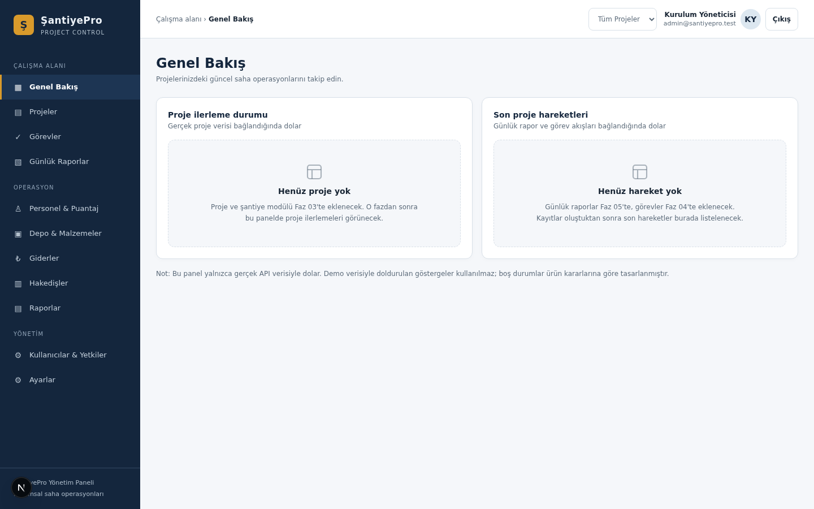
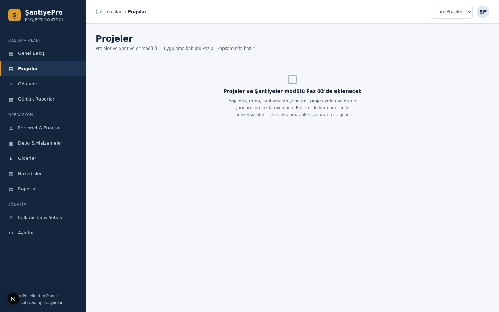
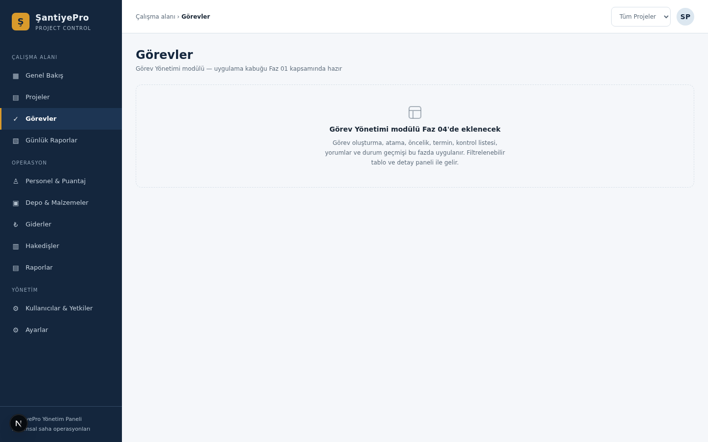
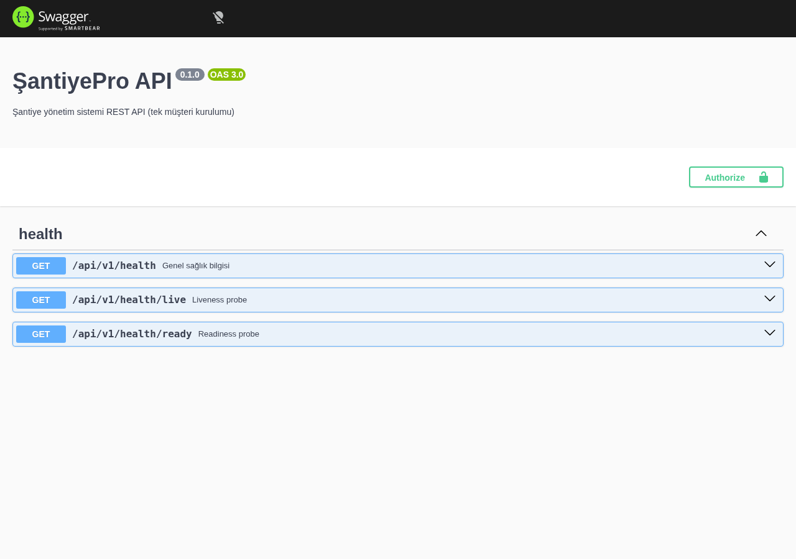
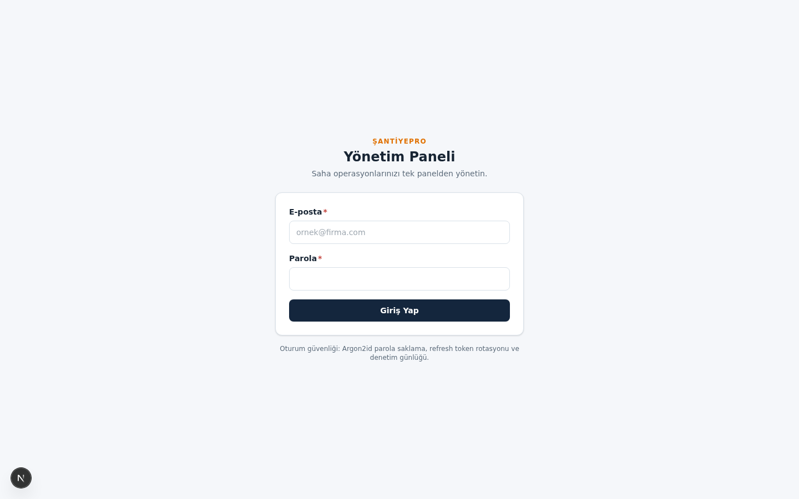
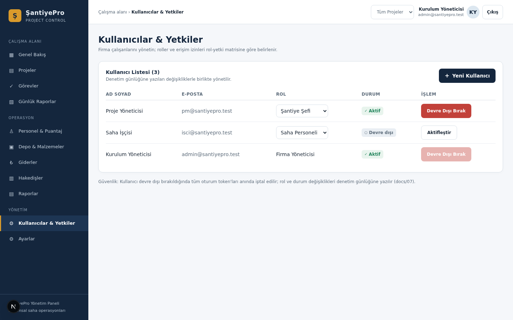
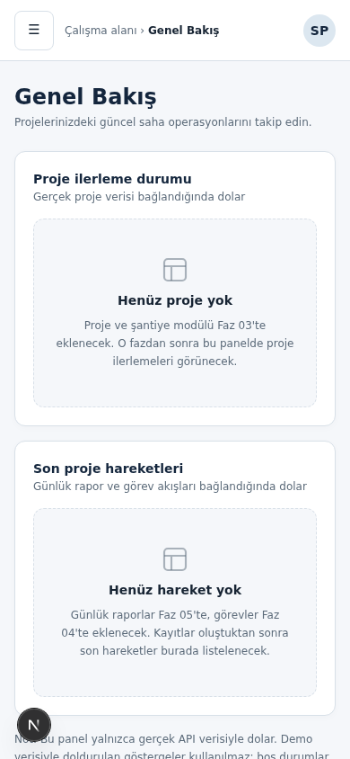
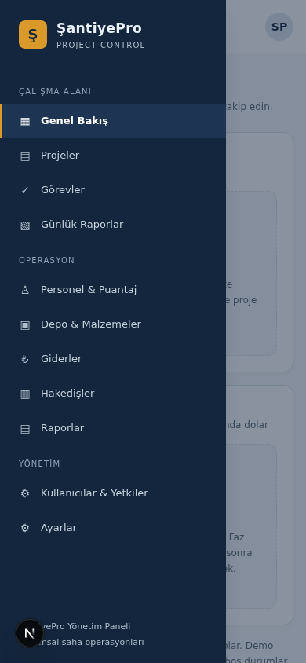
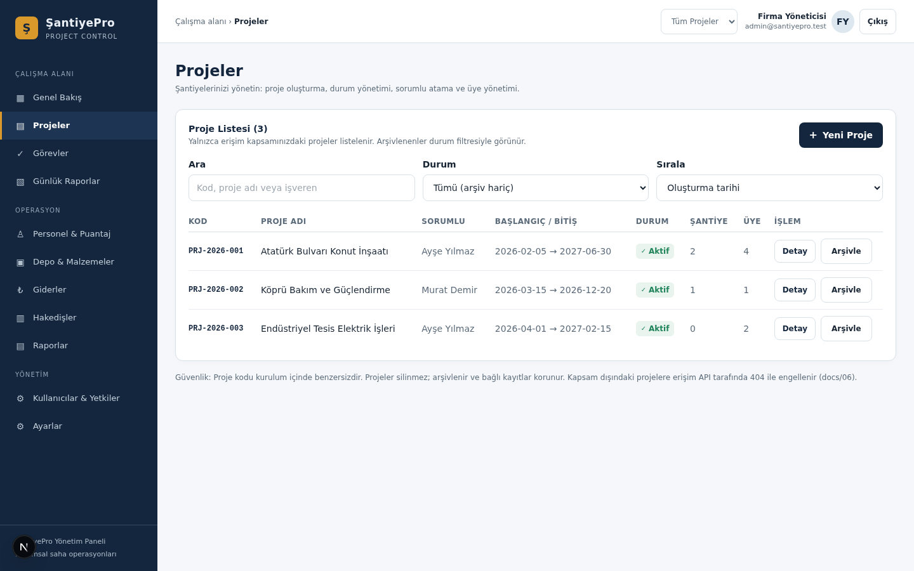
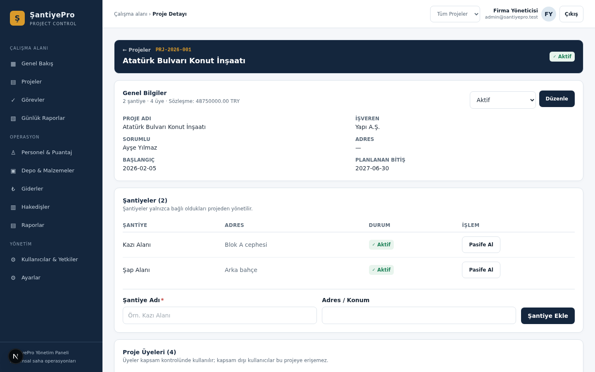

<div align="center">

# 🏗️ ŞantiyePro

**Şantiye ve inşaat takip platformu — saha mobil uygulaması, web yönetim paneli ve API**

[](https://github.com/aliyuzerler/SantiyePro/actions/workflows/ci.yml)


*React Native + Expo · Next.js · NestJS · PostgreSQL*

</div>

---

## 📌 Genel Bakış

ŞantiyePro; inşaat firmalarının şantiyelerini tek panelden yönetmesi için geliştirilen, **tek müşteri kurulumlu** (single-tenant) bir yönetim platformudur. Saha ekibi çevrimdışı çalışabilen mobil uygulamayla günlük rapor, puantaj, depo ve gider kayıtlarını tutar; yönetim panelinden proje ilerlemesi, hakedişler ve raporlar izlenir.

Ürünün temel ilkeleri:

- **Çevrimdışı-öncelikli saha uygulaması** — bağlantı yoksa kayıt yerel SQLite'a yazılır, bağlantı gelince outbox kuyruğuyla sunucuya aktarılır (`docs/09-offline-sync.md`).
- **Rol tabanlı erişim (RBAC) + proje kapsamı** — her kullanıcı yalnızca yetkili olduğu proje ve rol kapsamındaki veriyi görür; IDOR koruması tüm uçlarda zorunludur.
- **Değiştirilemez kayıtlar** — stok hareketleri, hakediş ve ilerleme kayıtları append-only tutulur; tüm kritik işlemler **denetim günlüğüne** (audit log) yazılır.
- **Tasarım sistemi tek kaynağı** — `design/tokens.json` web, mobil ve API dokümantasyonu için ortak token kaynağıdır; üç taraf arasında parite testleriyle kilitlenir.
- **Abonelik / ödeme yok** — tek seferlik kurulum lisansı (ADR-001, ADR-004).

## 🖼️ Ekran Görüntüleri

### Web Yönetim Paneli (Faz 01)

| Genel Bakış | Projeler |
| --- | --- |
|  |  |

| Görevler | API Dokümantasyonu (Swagger) |
| --- | --- |
|  |  |

### Kimlik Doğrulama ve Kullanıcı Yönetimi (Faz 02)

| Giriş Ekranı | Kullanıcılar & Yetkiler (gerçek veri) |
| --- | --- |
|  |  |

### Mobil Kabuk (Faz 01)

| Alt navigasyon + kayıt menüsü FAB | Gezinme çekmecesi |
| --- | --- |
|  |  |

> Mobil kabuğun tarayıcı önizlemesidir; asıl hedef Expo ile derlenen React Native uygulamasıdır (`apps/mobile`). Ekran görüntüleri `docs/screenshots/` altında sürüm kontrolünde tutulur.

### Projeler ve Şantiyeler (Faz 03)

| Proje Listesi (gerçek veri) | Proje Detayı — aktif proje bağlamı |
| --- | --- |
|  |  |

- Proje oluşturma/düzenleme, kurallı durum geçişleri (arşivleme dahil), sorumlu atama.
- Şantiye yönetimi proje içinde; üye yönetimi kapsam rolüyle (MANAGER, CHIEF, …).
- Kapsamlı liste: FIRM_ADMIN tümünü, diğerleri yalnızca üye olduğu projeleri görür (IDOR → 404).
- Listede sayfalama, arama, durum filtresi ve sıralama; mobilde sekmeli detay.

## 🧱 Mimari

```text
┌─────────────────┐     ┌──────────────────────┐
│  Mobil (Expo)   │     │  Web Panel (Next.js) │
│  offline-first  │     │  yönetim arayüzü     │
└────────┬────────┘     └──────────┬───────────┘
         │  REST /api/v1           │
         ▼                         ▼
┌─────────────────────────────────────────────┐
│           API — NestJS (modüler monolit)    │
│  Auth/RBAC · Projeler · Görevler · Raporlar │
│  Puantaj · Depo · Gider/Hakediş · Denetim   │
└────────────────────┬────────────────────────┘
                     ▼
      ┌──────────────────────┐   ┌───────────────────┐
      │  PostgreSQL 16/17    │   │  MinIO (S3) medya │
      └──────────────────────┘   └───────────────────┘
```

- **Modüler monolit:** Tek dağıtım birimi; modüller faz bazında ayrı NestJS modülleri olarak büyür (`docs/03-architecture.md`).
- **Paylaşılan sözleşmeler:** DTO/şemalar ve tasarım token'ları `packages/contracts` içinde; API, web ve mobil aynı kaynaktan beslenir.
- **Ortak yapılandırma:** `packages/config` strict TypeScript + ESLint tabanı.

## 🗺️ Faz Yol Haritası

Geliştirme `prompts/README.md` içindeki faz sırasına göre yürür; her faz **önce geliştirme promptu, ardından test promptu** ile kapanır ve test raporu `docs/test-reports/` altına yazılır. Testleri geçmeyen faz kapanmaz.

| Faz | Kapsam | Durum |
| --- | --- | --- |
| 00 | Monorepo iskeleti, CI, yerel PostgreSQL, health uçları | ✅ Tamamlandı |
| 01 | Tasarım sistemi, token paritesi, web panel kabuğu + mobil kabuk | ✅ Tamamlandı |
| 02 | Kimlik doğrulama, kullanıcılar, RBAC, denetim günlüğü | ✅ Tamamlandı |
| 03 | Projeler ve ekip yönetimi | 🔄 Devam ediyor |
| 04 | Görevler | ⬜ |
| 05 | Günlük raporlar ve medya | ⬜ |
| 06 | Puantaj | ⬜ |
| 07 | Depo / stok | ⬜ |
| 08 | Giderler ve hakedişler | ⬜ |
| 09 | Çevrimdışı senkronizasyon | ⬜ |
| 10 | Raporlar, denetim görünümleri, yedekleme | ⬜ |
| 11 | Üretim sertleştirme | ⬜ |

Faz raporları: [phase-00](docs/test-reports/phase-00.md) · [phase-01](docs/test-reports/phase-01.md) · [phase-02](docs/test-reports/phase-02.md)

## 🚀 Hızlı Başlangıç

### Gereksinimler

- Node.js >= 20 (önerilen 22/24)
- pnpm (`corepack enable` veya `npm i -g pnpm`)
- PostgreSQL 16+ — Docker varsa Compose ile, yoksa `pnpm local:pg` ile

### Kurulum

```bash
pnpm install

# 1) Veritabanı
#    Docker'lı ortam:
docker compose -f infra/docker/compose.dev.yml up -d
#    Docker'sız ortam (yerel PostgreSQL 17 daemon):
pnpm local:pg

# 2) API ortam dosyası
cp .env.example apps/api/.env   # değerleri ortamınıza göre düzenleyin

# 3) Prisma client üretimi
pnpm --filter @santiyepro/api prisma:generate

# 4) Paylaşılan paketi derle (API runtime dist kullanır)
pnpm --filter @santiyepro/contracts build

# 5) Geliştirme sunucuları (ayrı terminaller)
pnpm dev:api      # http://localhost:4000/api/v1/health
pnpm dev:web      # http://localhost:3100
pnpm dev:mobile   # Expo DevTools (Expo Go ile cihazda)
```

## 🧪 Test ve Kalite Kapısı

Her fazda aşağıdaki komutlar yeşil olmadan faz kapanmaz:

```bash
pnpm lint        # tüm workspace
pnpm typecheck   # tüm workspace
pnpm test        # birim + e2e testler
pnpm build       # contracts -> api/web derlemesi
pnpm e2e         # Playwright CANLI E2E (gerçek API + gerçek PostgreSQL + tarayıcı)
```

**Canlı E2E standardı (Faz 03 kapanışından itibaren):** `apps/web-e2e` paketi her faz
kapanmadan **gerçek ortamda** koşar — gerçek UI girişi, menüdeki 11 modül sayfası,
mobil drawer akışı ve fazın kendi kritik akışı (gerçek mock'suz API + PostgreSQL).
Ayrıntılar: [`docs/process/canli-test-standardi.md`](docs/process/canli-test-standardi.md).

**Mevcut test envanteri (Faz 05 itibarıyla — 228 test + canlı E2E):**

| Paket | Araç | Kapsam |
| --- | --- | --- |
| `packages/contracts` | Vitest | Token paritesi + görev/rapor durum makineleri, gecikme, izin matrisi, medya allowlist (27 test) |
| `apps/api` | Vitest | Health + auth birim + medya güvenliği (EXIF strip, magic sniff, imzalı URL) (17 test) |
| `apps/api` e2e | Vitest + gerçek PostgreSQL | auth 17 + görev 21 + **günlük rapor 11 + medya 12** + proje 16 + health 5 = 82 e2e |
| `apps/web` | Vitest + Testing Library | Token CSS paritesi, UI, oturum, kullanıcı, proje, görev, **rapor listesi/detay/galeri** (50 test) |
| `apps/mobile` | Jest + RNTL | UI, oturum, kabuk, proje, görev, **günlük rapor formu + çevrimdışı medya kuyruğu** (52 test) |
| `apps/web-e2e` | **Playwright (canlı)** | API sağlık, kabuk + drawer, görev ve **rapor kritik akışları** (15 koşu) |

Yerel tam yığın doğrulama (Docker'sız):

```bash
bash infra/scripts/health-check.sh
# PostgreSQL + API'yi başlatır; /health, /health/live, /health/ready, /docs uçlarını doğrular; kapatır.
```

## 🐳 Docker (Müşteri / Üretim Kurulumu)

```bash
cd infra/docker
cp ../../.env.example .env   # secret'ları doldurun
docker compose up -d --build
```

Üretim profili: `web` + `api` + `db` (private network, dışarıya kapalı) + `object-storage` (MinIO) + `proxy` (Caddy/TLS). Detay: `docs/10-deployment-backup.md`.

## 📚 Dokümantasyon Haritası

| Konum | İçerik |
| --- | --- |
| `docs/01-product-brief.md` | Ürün tanımı ve hedefler |
| `docs/02-scope-and-acceptance.md` | Kapsam ve kabul kriterleri |
| `docs/03-architecture.md` | Mimari kararlar, modüler monolit |
| `docs/04-data-model.md` | Veri modeli |
| `docs/05-api-contracts.md` | API sözleşmeleri |
| `docs/06-roles-permissions.md` | Rol-izin matrisi |
| `docs/07-security-rules.md` | Güvenlik kuralları (Argon2id, token stratejisi, IDOR) |
| `docs/09-offline-sync.md` | Çevrimdışı senkronizasyon protokolü |
| `docs/10-deployment-backup.md` | Kurulum ve yedekleme |
| `docs/11-testing-strategy.md` | Test stratejisi |
| `docs/adr/` | Mimari karar kayıtları (ADR) |
| `design/` | Tasarım sistemi, token'lar, ekran spec'leri |
| `rules/` | Genel / mobil / backend / UI-UX / test kuralları |
| `prompts/` | Faz bazlı geliştirme ve test promptları |

## 🔐 Güvenlik Notları

- Şifreler **Argon2id** ile saklanır (OWASP parametreleri); token'lar mobilde **SecureStore**'da tutulur (AsyncStorage yasak).
- Access token 15 dk; **refresh token rotasyonu + reuse tespiti + logout revoke** aktif (Faz 02).
- Web refresh token HttpOnly cookie (`SameSite=Strict`; üretimde `Secure`), mobilde gövde + SecureStore.
- Deny-by-default RBAC: global guard'lar + rol-izin matrisi (docs/06); disable edilen kullanıcının tüm oturumları anında iptal edilir.
- Kritik olaylar (login, parola, kullanıcı/rol değişikliği) **denetim günlüğüne** maskelenmiş gövdelerle yazılır.
- Gerçek secret'lar repoya girmez; `.env.example` yalnızca değişken adlarını içerir (`.gitignore`).

## 📄 Lisans ve Ticari Model

Tek seferlik kurulum/kullanım lisansı; abonelik, uygulama içi ödeme veya online lisans kontrolü **yoktur** (ADR-001, ADR-004).
